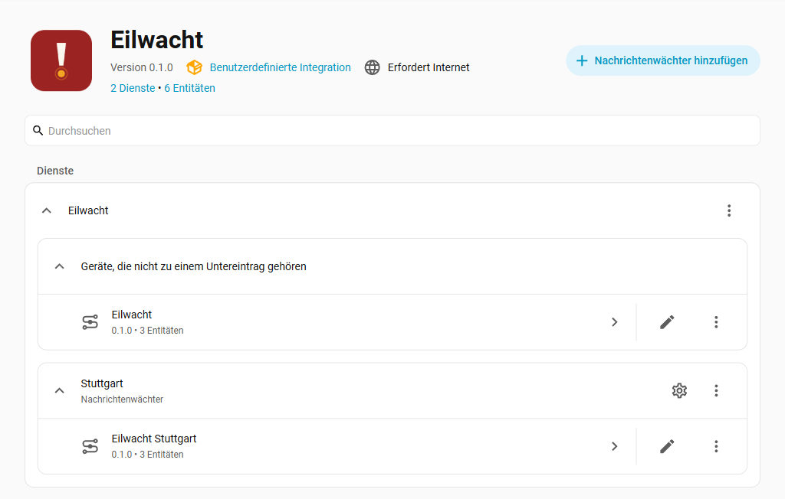
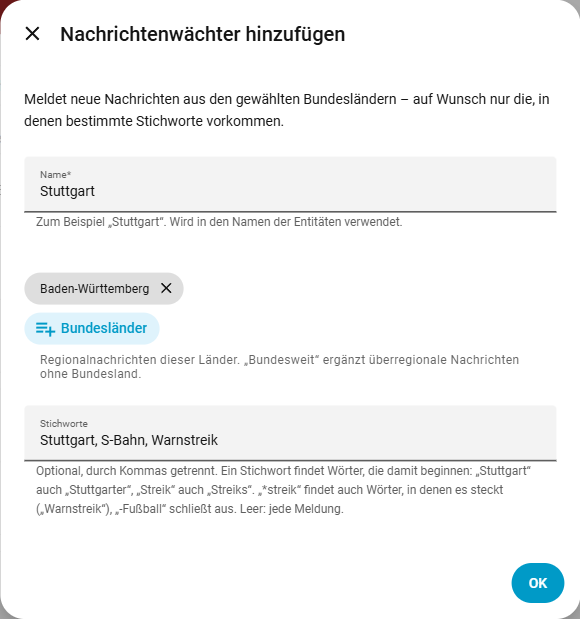
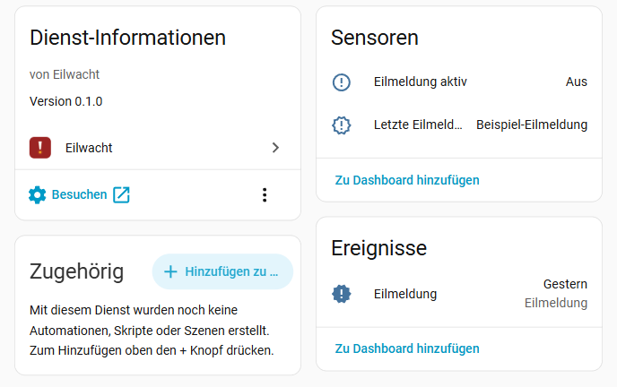
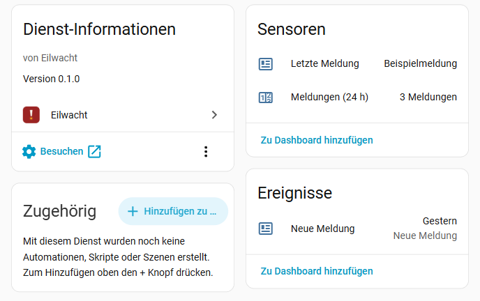

<picture>
  <source media="(prefers-color-scheme: dark)" srcset="https://raw.githubusercontent.com/eilwacht/integration/main/assets/github/readme-header-dark@2x.png">
  
</picture>

[](https://hacs.xyz/)
[](https://github.com/eilwacht/integration/releases)
[](https://github.com/eilwacht/integration/actions/workflows/ci.yml)
[](LICENSE)
[](https://eilwacht.github.io/integration/?lang=de)

Eilwacht bringt Eilmeldungen und Regionalnachrichten der Tagesschau in dein Home Assistant – nicht als Nachrichtenleser, sondern als Auslöser: für eine Push-Nachricht, eine Ansage in der Küche oder ein Lichtsignal. Nachrichtenwächter melden dir neue Meldungen aus deinem Bundesland, auf Wunsch nur die mit bestimmten Stichworten wie „Warnstreik“ oder „S-Bahn“.

**Ausprobieren ohne Installation:** Die [Demo](https://eilwacht.github.io/integration/?lang=de) hat einen Stichwort-Tester – tippe Stichworte wie im Wächter-Dialog und sieh, welche Meldungen gemeldet würden – und zeigt Geräte, Dashboard-Karte, Verlauf und Push-Nachrichten, ruhig und bei laufender Eilmeldung. Alle Meldungen dort sind erfunden.

*English:* Home Assistant integration for breaking news and regional news from Germany's public broadcaster Tagesschau, as triggers for automations. German-language content only.

## Inhalt

- [Was Eilwacht kann](#was-eilwacht-kann) · [Datenquelle](#datenquelle) · [Was Eilwacht nicht kann](#was-eilwacht-nicht-kann)
- **Loslegen:** [Installation](#installation) · [Einrichtung](#einrichtung) · [Eilmeldungen](#eilmeldungen) · [Nachrichtenwächter](#nachrichtenwächter) · [Entitäten](#entitäten)
- **[Was du damit bauen kannst](#was-du-damit-bauen-kannst):** [Blueprints](#fertige-blueprints) · [Licht rot bei Eilmeldung](#licht-kurz-rot-färben-bei-einer-eilmeldung) · [Letzte Eilmeldung im Dashboard](#letzte-eilmeldung-im-dashboard)
- **Mehr:** [Datenschutz](#datenschutz) · [Fehlerbehebung](#fehlerbehebung) · [Fehler melden](#fehler-melden) · [Weitere Wachten](#weitere-wachten)

## Was Eilwacht kann

- **Eilmeldungen** der Tagesschau als Event, als Binärsensor „Eilmeldung aktiv“ und als Sensor „Letzte Eilmeldung“ – ohne Einrichtung, sofort nach dem Hinzufügen.
- **Nachrichtenwächter** für ein oder mehrere Bundesländer, auf Wunsch auch bundesweit: Event bei jeder neuen Meldung, letzte Meldung, Zahl der Meldungen der letzten 24 Stunden.
- **Stichwortwächter:** nur Meldungen mit bestimmten Wörtern, mit Platzhaltern und Ausschlüssen.
- **Fertige Blueprints** für Push-Nachricht und Ansage, mit Ruhezeiten.
- Fällt eine Quelle aus, erscheint nach einer Weile ein Hinweis unter *Reparaturen*.
- **Schont SD-Karten:** Eilwacht schreibt nur, wenn sich etwas ändert – wichtig für Home Assistant auf einem Raspberry Pi.



## Datenquelle

Alle Daten kommen von [tagesschau.de](https://www.tagesschau.de):

| Was | Woher | Wie oft |
| --- | --- | --- |
| Eilmeldungen | die Kopfzeile der Website (`json/headerapp`) | jede Minute |
| Eilmeldungen, Ersatzquelle | Startseite der Tagesschau-API (`api2u/homepage`, Feld `breakingNews`) | nur solange die erste Quelle ausfällt, dann alle 2 Minuten |
| Regionalnachrichten | Tagesschau-API (`api2u/news`), alle Bundesländer aller Wächter in einer Abfrage | alle 15 Minuten |

Die Nutzungsbedingungen der Tagesschau erlauben die Nutzung für den **privaten, nicht-kommerziellen Gebrauch** und höchstens 60 Abrufe pro Stunde. Eilwacht bleibt mit höchstens 8 Abrufen pro Stunde (38, solange die Kopfzeile ausfällt) darunter. Jede Home-Assistant-Instanz ruft die Daten selbst ab; es gibt keinen zentralen Server.

**Eilwacht ist kein Angebot der ARD oder der Tagesschau** und steht mit ihnen in keiner Verbindung.

## Was Eilwacht nicht kann

- **Nur die Tagesschau.** Andere Sender (ZDF, Deutschlandfunk, SWR, n-tv) kennzeichnen Eilmeldungen nicht maschinenlesbar. Für beliebige RSS-Feeds gibt es in Home Assistant die Integration [Feedreader](https://www.home-assistant.io/integrations/feedreader/).
- **Keine Volltexte und Bilder** – Schlagzeile, Dachzeile, erster Satz und der Link zum Artikel.
- **Keine amtlichen Warnungen.** Dafür gibt es [NINA](https://www.home-assistant.io/integrations/nina/) und die [DWD-Wetterwarnungen](https://www.home-assistant.io/integrations/dwd_weather_warnings/).
- **Nur kurze Pausen werden nachgeholt:** Was während eines Neustarts von Home Assistant erscheint, wird danach gemeldet. War Home Assistant länger als 6 Stunden aus, lernt Eilwacht still neu – sonst käme nach einem Tag Pause eine Flut von Nachrichten.
- **Eilmeldungen sind selten.** Die Tagesschau verschickt sie nur bei wirklich wichtigen Ereignissen. Im Alltag melden sich die Nachrichtenwächter deutlich öfter.

## Datenschutz

Eilwacht ruft nur tagesschau.de ab. Deine Bundesländer und Stichworte bleiben in Home Assistant; die Abfrage enthält nur die Nummern der Bundesländer.

## Installation

Voraussetzung: Home Assistant **2026.3** oder neuer; vor 2026.11 dazu [HACS](https://hacs.xyz/).

**Mit einem Klick:** [](https://my.home-assistant.io/redirect/hacs_repository/?owner=eilwacht&repository=integration&category=integration) → installieren, Home Assistant neu starten → [](https://my.home-assistant.io/redirect/config_flow_start/?domain=eilwacht)

Oder von Hand:

1. *Einstellungen → Marketplace → Durchstöbern*, nach **Eilwacht** suchen → **Installieren** (vor Home Assistant 2026.11: in HACS → **Herunterladen**).
2. Home Assistant neu starten.
3. **Einstellungen → Geräte & Dienste → Integration hinzufügen → Eilwacht**.

Hinweis: Im alten HACS-Dashboard (vor Home Assistant 2026.11) fehlt das Icon ([HACS-Issue #5171](https://github.com/hacs/integration/issues/5171)); im Marketplace und in den Einstellungen wird es angezeigt.

## Einrichtung

### Eilmeldungen

Nichts zu tun: Nach dem Hinzufügen gibt es das Gerät **Eilwacht** mit den Eilmeldungs-Entitäten.

### Nachrichtenwächter

*Geräte & Dienste → Eilwacht → Nachrichtenwächter hinzufügen*:




| Feld | Bedeutung |
| --- | --- |
| **Name** | z. B. „Stuttgart“ oder „Streik“; erscheint in den Namen der Entitäten |
| **Bundesländer** | Regionalnachrichten dieser Länder. **Bundesweit** ergänzt überregionale Nachrichten ohne Bundesland. |
| **Stichworte** | optional, durch Kommas getrennt; leer heißt: jede Meldung |

Stichworte durchsuchen Dachzeile, Schlagzeile, ersten Satz und Schlagwörter der Meldung, ohne Rücksicht auf Groß- und Kleinschreibung. Ein Stichwort findet alle Wörter, die damit **beginnen** – so klappt es auch mit Mehrzahl, Beugung und zusammengesetzten Wörtern:

| Eingabe | findet | findet nicht |
| --- | --- | --- |
| `Stuttgart` | „Stuttgart“, „Stuttgarter Gänsheide“ | |
| `Streik` | „Streik“, „Streiks“, „Streikende“ | „Warnstreik“ |
| `*streik` | „Warnstreik“, „Bahnstreiks“, „Streik“ | |
| `Bahn` | „Bahn“, „Bahnhof“ | „Autobahn“, „S-Bahn“ |
| `S-Bahn Stuttgart` | „S-Bahn Stuttgart“, „S-Bahn Stuttgarts“ | „S-Bahn in Stuttgart“ |
| `-Fußball` | schließt Meldungen mit „Fußball“ oder „Fußballer“ aus | |

Wächter lassen sich jederzeit über ⋮ → **Neu konfigurieren** ändern.

## Entitäten

Entitäts-IDs bei deutscher Oberfläche, Wächter mit dem Namen „Stuttgart“:

| Entität | Beispiel-ID | Inhalt |
| --- | --- | --- |
| **Eilmeldung** (Event) | `event.eilwacht_eilmeldung` | löst bei jeder neuen Eilmeldung aus, Ereignistyp `breaking_news` |
| **Eilmeldung aktiv** | `binary_sensor.eilwacht_eilmeldung_aktiv` | an, solange tagesschau.de eine Eilmeldung zeigt; Attribute `titles`, `urls` |
| **Letzte Eilmeldung** | `sensor.eilwacht_letzte_eilmeldung` | Schlagzeile der letzten Eilmeldung; bleibt nach ihrem Ende und über Neustarts erhalten |
| **Bericht für Fehlermeldung** (Schaltfläche, unter *Diagnose*) | `button.eilwacht_bericht_fur_fehlermeldung` | zeigt einen kurzen Bericht zum Kopieren in ein Issue, siehe [Fehler melden](#fehler-melden) |
| **Neue Meldung** (Event) | `event.eilwacht_stuttgart_neue_meldung` | löst bei jeder neuen Meldung des Wächters aus, Ereignistyp `news` |
| **Letzte Meldung** | `sensor.eilwacht_stuttgart_letzte_meldung` | Schlagzeile der neuesten Meldung des Wächters |
| **Meldungen (24 h)** | `sensor.eilwacht_stuttgart_meldungen_24_h` | Zahl der Meldungen des Wächters aus den letzten 24 Stunden |

Events und die Sensoren mit Schlagzeile tragen dieselben Attribute: `title`, `topline` (Dachzeile), `summary` (erster Satz), `url`, `published`, `regions`, `ressort` und bei Wächtern mit Stichworten `keywords` (die gefundenen Stichworte).

<table>
  <tr>
    <td valign="top"></td>
    <td valign="top"></td>
  </tr>
</table>

<sub>Screenshots mit Beispieltexten statt echter Schlagzeilen.</sub>

## Was du damit bauen kannst

### Fertige Blueprints

Ohne YAML: Blueprint importieren, Entität und Handy auswählen, fertig.

| Blueprint | Was sie tut | |
| --- | --- | --- |
| **Eilmeldung aufs Handy** | Push-Nachricht bei jeder neuen Eilmeldung; ein Tippen öffnet den Artikel. Ruhezeit (Standard 22–7 Uhr) | [](https://my.home-assistant.io/redirect/blueprint_import/?blueprint_url=https%3A%2F%2Fgithub.com%2Feilwacht%2Fintegration%2Fblob%2Fmain%2Fblueprints%2Fautomation%2Feilwacht%2Feilmeldung_push.yaml) |
| **Eilmeldung ansagen** | liest die Schlagzeile über Lautsprecher vor, auf Wunsch nur wenn jemand zu Hause ist. Ruhezeit (Standard 21:30–7:30 Uhr) | [](https://my.home-assistant.io/redirect/blueprint_import/?blueprint_url=https%3A%2F%2Fgithub.com%2Feilwacht%2Fintegration%2Fblob%2Fmain%2Fblueprints%2Fautomation%2Feilwacht%2Feilmeldung_ansage.yaml) |
| **Neue Meldung eines Nachrichtenwächters aufs Handy** | Push-Nachricht bei jeder neuen Meldung eines Wächters, mit Dachzeile oder gefundenem Stichwort als Titel. Ruhezeit (Standard 22–7 Uhr) | [](https://my.home-assistant.io/redirect/blueprint_import/?blueprint_url=https%3A%2F%2Fgithub.com%2Feilwacht%2Fintegration%2Fblob%2Fmain%2Fblueprints%2Fautomation%2Feilwacht%2Fneue_meldung_push.yaml) |

Die Push-Nachrichten gehen an ein Handy mit der offiziellen Home-Assistant-App.

### Licht kurz rot färben bei einer Eilmeldung

```yaml
alias: Eilmeldung – Licht
triggers:
  - trigger: state
    entity_id: event.eilwacht_eilmeldung
conditions:
  # Nach einem Neustart zeigt die Event-Entität ihr letztes Ereignis erneut an.
  - condition: template
    value_template: >-
      {{ trigger.from_state is not none
         and trigger.from_state.state != 'unavailable'
         and trigger.to_state.state not in ['unavailable', 'unknown'] }}
actions:
  - action: light.turn_on
    target:
      entity_id: light.wohnzimmer
    data:
      color_name: red
      flash: short
```

### Letzte Eilmeldung im Dashboard

```yaml
type: markdown
title: Eilmeldung
content: >-
  
  
  **[{{ s.state }}]({{ s.attributes.url }})**

  {{ s.attributes.summary or '' }}

  <small>{{ as_timestamp(s.attributes.published) | timestamp_custom('%d.%m. %H:%M') if s.attributes.published else '' }} · Quelle: tagesschau.de</small>
  
  Keine Eilmeldung.
  
```

## Fehlerbehebung

- **Reparaturen:** Ist die Eilmeldungs-Quelle 30 Minuten lang nicht erreichbar oder schlagen die Nachrichten zweimal in Folge fehl, erscheint unter *Einstellungen → System → Reparaturen* ein Hinweis. Er verschwindet von selbst, sobald der Abruf wieder klappt.
- **Bericht für Fehlermeldung:** Schaltfläche am Gerät „Eilwacht“ unter *Diagnose*, siehe [Fehler melden](#fehler-melden). Er zeigt auch, welcher Abruf gerade ausfällt und mit welchem Fehler.
- **Diagnose:** *Geräte & Dienste → Eilwacht → ⋮ → Diagnose herunterladen*. Sie enthält deine Wächter samt Namen und Stichworten und die zuletzt aufgezeichnete Eilmeldung im Rohformat, siehe [Was steht in der Diagnose-Datei?](#was-steht-in-der-diagnose-datei).
- **Ausführliches Protokoll:**

  ```yaml
  logger:
    logs:
      custom_components.eilwacht: debug
  ```

## Fehler melden

Fehler und Ideen bitte als [GitHub-Issue](https://github.com/eilwacht/integration/issues), bei Fehlern mit dem **Bericht für Fehlermeldung**: *Geräte & Dienste → Eilwacht → Gerät „Eilwacht“ → Diagnose → Bericht für Fehlermeldung* drücken. Der Bericht erscheint als Benachrichtigung (Glocke unten links) zum Kopieren. Er enthält die Versionen von Eilwacht und Home Assistant, den Zustand der drei Abrufe bei tagesschau.de (in Ordnung oder wie oft in Folge fehlgeschlagen, mit Fehlermeldung), die Zahl der Wächter, laufenden Eilmeldungen und abgerufenen Meldungen, je Wächter die Bundesländer und die **Zahl** der Stichworte, welche Entitäten keinen Wert haben und offene Reparaturhinweise. Entity-IDs, Namen der Wächter, Stichworte und Schlagzeilen stehen nicht darin. Lies ihn trotzdem vor dem Teilen und lösche, was du nicht zeigen willst. Greift ein Stichwort nicht wie erwartet, nenne im Issue ein Beispiel, das den Fehler zeigt. Sicherheitslücken bitte vertraulich, siehe [SECURITY.md](https://github.com/eilwacht/integration/blob/main/SECURITY.md).

### Was steht in der Diagnose-Datei?

Reicht der Bericht nicht, kommt im Issue die Bitte um die Diagnose-Datei (*Geräte & Dienste → Eilwacht → ⋮ → Diagnose herunterladen*). Sie ist ausführlicher, und nicht alles darin kommt von Eilwacht:

- **Von Home Assistant** (jede Integration hat diesen Kopf, Eilwacht kann ihn nicht ändern): Version und Installationsart, Betriebssystem, Zeitzone und unter `custom_components` die Liste **aller** installierten benutzerdefinierten Integrationen mit Versionen. Diese Blöcke darfst du vor dem Hochladen löschen, sie werden nicht gebraucht.
- **Von Eilwacht** (unter `data`): die Version, unter `watches` jeder Wächter mit **Name, Bundesländern und Stichworten**, unter `breaking` und `news` der Zustand der Abrufe (letzter Abruf erfolgreich, Fehlversuche in Folge, letzter Fehler, Abrufabstand), die laufenden Eilmeldungen, die zuletzt aufgezeichnete Eilmeldung im Rohformat der Tagesschau (`recorded_sample`), die abgerufenen Bundesländer, die Zahl der Meldungen und die ersten drei Meldungen mit Schlagzeile und Link.

Namen und Stichworte der Wächter darfst du vor dem Teilen ersetzen. Die aufgezeichnete Eilmeldung bitte stehen lassen, wenn es um Eilmeldungen geht – sie ist die einzige Quelle für das echte Format. Willst du die Datei nicht öffentlich teilen, ist das in Ordnung: Dann reichen meist der Bericht und gezielte Angaben, nach denen im Issue gefragt wird.

Pull Requests sind willkommen. Wie, steht in [CONTRIBUTING.md](https://github.com/eilwacht/integration/blob/main/CONTRIBUTING.md).

## Weitere Wachten

Vom selben Autor und nach demselben Muster gebaut: Einrichtung über die Oberfläche, deutsch und englisch, schonend für SD-Karten.

- **Energie**
  - [Einspeisewacht](https://github.com/einspeisewacht/integration) – was negative Strompreise bei der PV-Einspeisung kosten (§ 51 EEG) · [Demo](https://einspeisewacht.github.io/integration/?lang=de)
  - [Tarifwacht](https://github.com/tarifwacht/integration) – was der eigene Strombezug mit anderen Tarifen gekostet hätte, auch dynamisch und mit Modul 3 · [Demo](https://tarifwacht.github.io/integration/?lang=de)
  - [Speicherwacht](https://github.com/speicherwacht/integration) – Wirkungsgrad, Zyklen und Kapazität des Batteriespeichers · [Demo](https://speicherwacht.github.io/integration/?lang=de)
  - [Wärmewacht](https://github.com/waermewacht/integration) – Arbeitszahlen und Gesundheits-Check der Wärmepumpe · [Demo](https://waermewacht.github.io/integration/?lang=de)
- **Alltag**
  - [Streckenwacht](https://github.com/streckenwacht/integration) – Baustellen, Sperrungen und Staus auf den eigenen Strecken · [Demo](https://streckenwacht.github.io/integration/?lang=de)

## Lizenz

MIT, siehe [LICENSE](LICENSE). Die Inhalte der Meldungen gehören der Tagesschau (ARD-aktuell) und dürfen nur privat genutzt werden.
